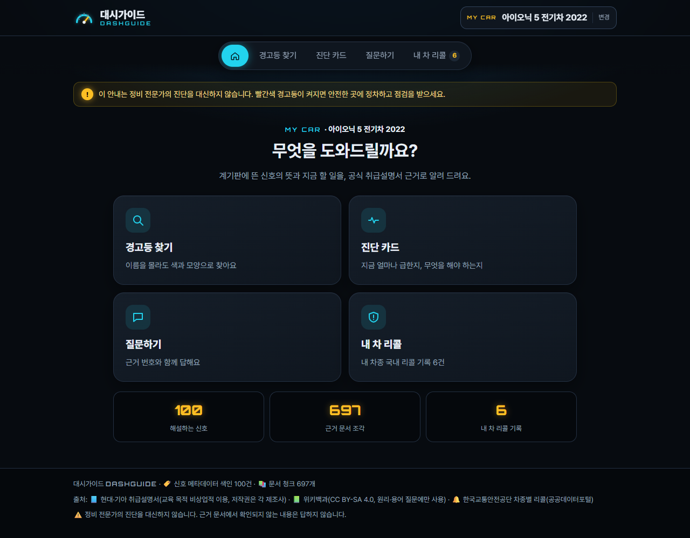
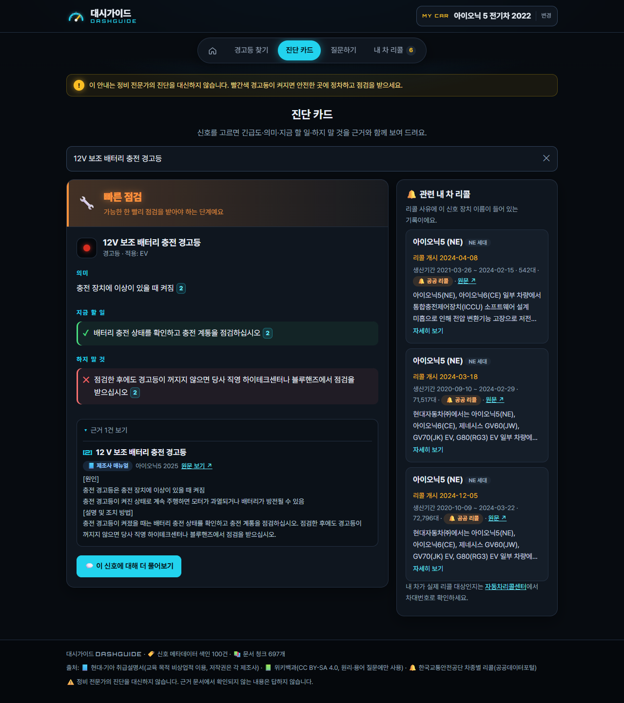
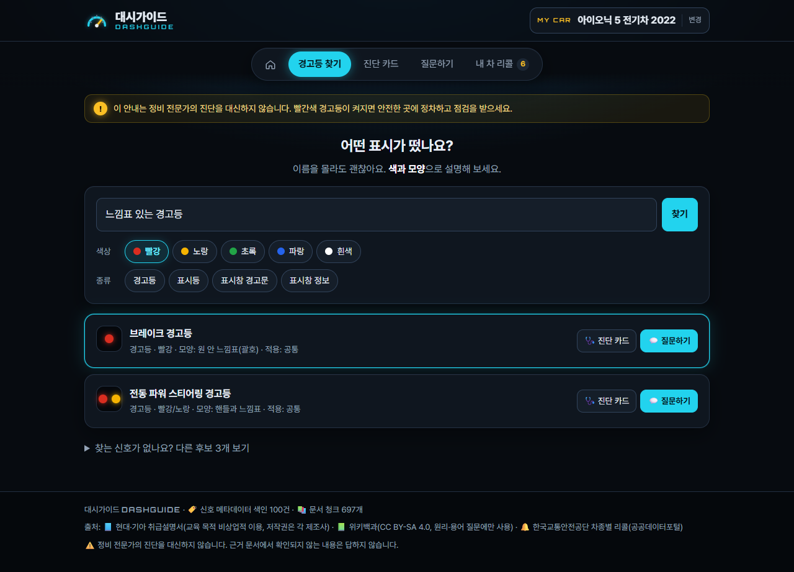
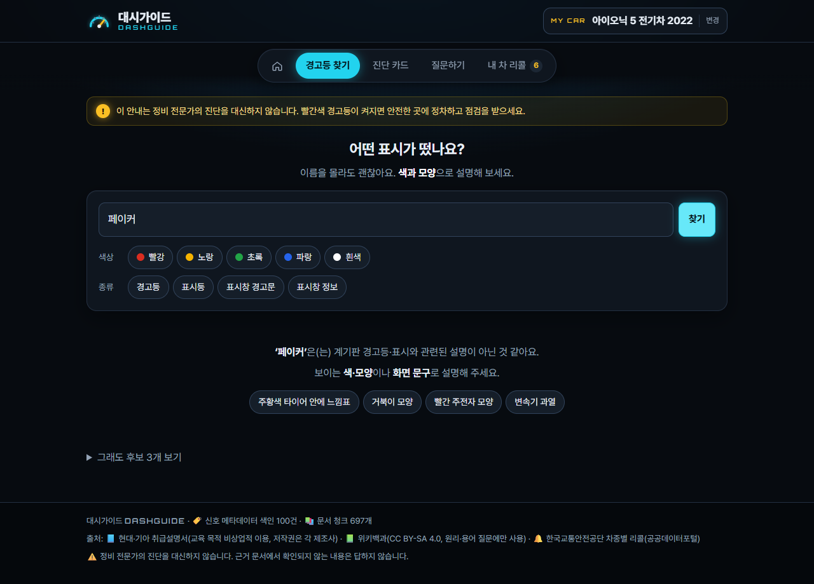
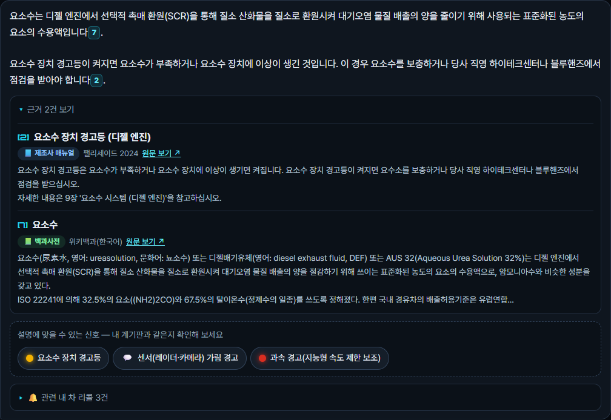
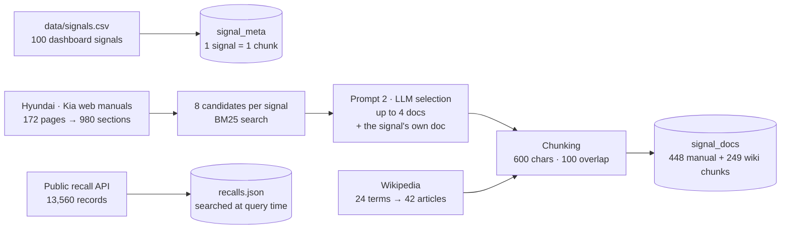
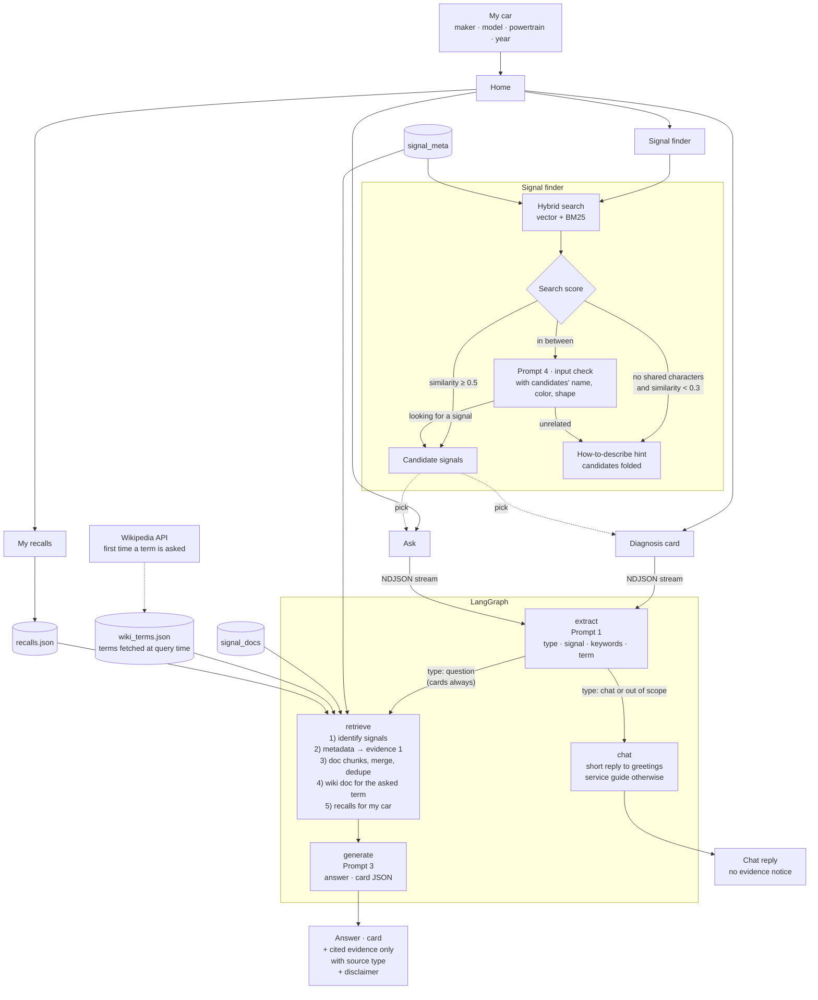

# DashGuide 대시가이드

**계기판 경고등·표시를 근거와 함께 해설하는 RAG 서비스**

운전 중 계기판에 처음 보는 표시가 뜨면, 이름을 몰라도 "주황색인데 타이어 안에 느낌표 있는 거"처럼 설명해서 찾을 수 있다. 찾은 신호에 대해 서비스가 세 가지를 알려 준다.
- 그 표시가 무슨 뜻인지
- 지금 무엇을 해야 하는지
- 내 차에 관련 리콜이 있었는지

모든 답에는 현대·기아 취급설명서, 위키백과, 공공 리콜 데이터의 **근거 번호**가 붙는다. 근거에 없는 내용은 "근거 문서에서 확인되지 않습니다"라고 답한다.

| 홈 | 진단 카드 |
|---|---|
|  |  |

> 이 서비스는 정비 전문가의 진단을 대신하지 않는다. 빨간색 경고등이 켜지면 안전한 곳에 정차하고 점검을 받아야 한다.

---

## 주요 기능

| 기능 | 설명 |
|---|---|
| 내 차 설정 | 첫 화면에서 제조사 → 차종 → 동력 방식 → 연식을 고른다. 같은 동력 방식의 매뉴얼을 먼저 근거로 쓰고, 리콜 검색에도 쓴다 |
| 경고등 찾기 | 색·모양 설명과 색·종류 필터로 신호 100개 중 후보를 찾는다(벡터 + BM25 하이브리드 검색). "페이커"·"후드티"처럼 계기판과 상관없는 입력이면 후보 대신 설명 방법을 안내한다 |
| 진단 카드 | 긴급도 6단계(즉시 정차 · 즉시 조치 · 빠른 점검 · 주의 · 정보 · 확인되지 않음)와 의미 · 지금 할 일 · 하지 말 것을 보여 준다. 문장마다 근거 번호가 붙고, 근거와 맞지 않는 행동 지시는 걸러낸다. 옆에는 같은 장치의 내 차 리콜을 보여 준다 |
| 질문하기 | 신호별로 대화를 이어 간다. 답변의 [n]을 누르면 근거 원문이 펼쳐진다. 인사는 짧은 대화로, 자동차와 상관없는 질문은 서비스 안내로 답한다. 장치 용어("액추에이터가 뭐야?")는 위키백과 문서를 받아 근거로 쓴다 |
| 내 차 리콜 | 한국교통안전공단 리콜 기록에서 내 차종·동력 방식·연식에 맞는 것을 모아 보여 준다. 실제 대상 여부는 차대번호로 확인하도록 안내한다 |

| 경고등 찾기 | 상관없는 입력 | 근거 종류 표시 |
|---|---|---|
|  |  |  |

---

## Pipeline

DashGuide is a retrieval-augmented generation (RAG) service over three source types:
- Hyundai·Kia owner's manuals: meaning of a signal and what to do
- Wikipedia: how a device works, terminology
- Korean public recall records: real defects for the user's car

It keeps two vector collections in ChromaDB:
- `signal_meta`: one chunk per dashboard signal
- `signal_docs`: manual and Wikipedia chunks linked to each signal

### 1. Data preparation and indexing (run once, cached in `data/raw` and `chroma_db`)



- **Signal metadata** (`signal_meta`)
  - Each of the 100 signals becomes one text with its name, type, color, shape, applicable powertrain, urgency and related system.
  - The chunk ID is the signal ID, so re-indexing never duplicates chunks.
- **Manual documents** (`signal_docs`)
  - Manual pages are split by subheading.
  - For each signal, BM25 finds 8 candidate sections. An LLM then picks up to 4 by title and summary only (prompt 2), and the signal's own section is always kept.
  - Selections are cached, so re-running costs no LLM calls.
- **Same paragraph in several manuals**: when another manual prints exactly the same paragraph as a signal's own section, that copy is indexed too. The answer can then cite the user's own car manual.
- **Recalls are not embedded.** They depend on the user's car, so they are filtered at query time by model, powertrain, year and device keywords.

### 2. Screens and query flow (`web/` → FastAPI `src/api/` → LangGraph `src/rag/graph.py`)



**Signal finder**
- Plain embeddings ranked a query like "turtle-shaped light" 20th to 50th, so vector search is fused with a character-bigram BM25 index using reciprocal rank fusion.
  - Colour synonyms are normalised (orange = yellow).
  - Everyday words are mapped to manual wording (spanner → wrench).
- Rank fusion always produces a top result, even for "Faker" or "hoodie". So the finder grades the search score:
  - Clearly unrelated input is rejected.
  - Clearly related input passes.
  - Only the ambiguous middle is sent to an LLM check (prompt 4). That check sees the candidate signals' colour and shape: "coffee-cup shape" is a real icon, "coffee shop" is not.
- The LLM check is sent twice in parallel and the first reply wins, because the API occasionally stalls for 17–19 s. If neither reply arrives in 6 s, candidates are shown anyway.

**Ask and diagnosis card (LangGraph)**
- **extract** (prompt 1) returns search terms plus a question *type*.
  - Greetings and off-topic questions go to a `chat` node: a short reply, or a fixed service guide with no LLM call.
  - Car facts are never answered without evidence. Without retrieval, the LLM reversed the meaning of the TPMS light in our comparison.
- **retrieve**
  1. Identifies up to three signals: the one picked on screen, then the extracted name, then the raw question.
  2. Always adds the signal's metadata chunk as evidence [1].
  3. Searches only those signals' documents and puts the user's car manual first.
  4. Merges identical paragraphs and groups chunks of the same document under one number.
  5. If a term's meaning was asked ("what is an actuator?"), fetches that Wikipedia article on first use and caches it.
  6. Recalls are added to the evidence only when the question asks about recalls; otherwise they are shown separately.
- **generate** (prompt 3)
  - Every factual sentence must carry a citation [n]. Missing information is stated as not found.
  - The UI shows only the evidence that was actually cited.
  - Card bullets without a citation are matched against the evidence by character bigrams (70 % overlap) or dropped.
- Each node streams a progress event to the browser (NDJSON), so the user sees which step is running.

Details: [docs/RAG_파이프라인_설계.md](docs/RAG_파이프라인_설계.md) (Korean).

---

## 평가와 결과

평가 스크립트는 `evaluation/`에 있다. 규칙·프롬프트를 조정할 때 본 질의(조정용)와, 결과를 보기 전에 정해 두고 조정에 쓰지 않은 질의(확인용)를 나눠서 쟀다.

| 평가 | 결과 |
|---|---|
| 경고등 찾기 정확도 (화면에 보이는 후보 기준) | 조정용 23건 Top-1 21 · Top-3 23, **확인용 12건 Top-1 10 · Top-3 11**, 오답 노출 평균 0.4건 |
| 신호 검색 방식 (15건 Top-3) | 벡터만 8 · 키워드만 14 · **하이브리드 15** |
| 상관없는 입력 판정 (확인용) | 엉뚱한 설명 10/10, 글자만 겹치는 말("오일 마사지") 10/10, 색·모양 낱말이 든 말("빨간 후드티") 13/13 걸러냄. 입력 검사를 거치는 정상 설명 10건은 하나도 안 걸러짐 |
| RAG 사용 전후 (9문항, 같은 모델) | 사실 정확성(정확·일부·오류) RAG 없이 1·5·2 → **RAG 4·4·0**, 근거 제시 0/9 → 8/8. 프롬프트 개선 후 2회 재실행 정확 5·7, 오류 0 ([비교](docs/RAG_전후_비교.md)) |
| 모델 비교 (5개 모델 × 9문항 × 2회) | 정확 16개 중 gpt-4o-mini 14 · gpt-4.1-mini 12 · gpt-5.4-mini 10 · gpt-5.4 15 · gpt-6-luna 15, 오류는 모두 0. 정확성·속도·비용을 보고 gpt-4o-mini 유지 ([비교](docs/모델_비교.md)) |
| 유사도 검색 vs MMR (12문항) | MMR은 겹치는 문서를 줄였지만(거의 같은 쌍 16 → 10) 빈자리에 상관없는 이웃 신호 문서가 들어와 유사도 검색 유지 ([비교](docs/MMR_비교.md)) |
| 처리 시간 | 검색·병합 1.6~2.3초. 전체는 LLM API 응답에 따라 보통 4~9초 |

RAG 없이 답하게 했을 때의 위험한 오류도 확인했다.
- TPMS 경고등이 바로 켜지는 것과 깜빡인 뒤 켜지는 것의 의미를 반대로 말했다.
- 변속기 과열 경고에 "시동을 끄라"고 답했다. 매뉴얼은 시동을 켠 채로 정차하라고 한다.

---

## 기술 스택

| 영역 | 사용 |
|---|---|
| LLM·임베딩 | OpenAI `gpt-4o-mini`, `text-embedding-3-small` (`.env`로 변경) |
| RAG | LangChain, LangGraph, ChromaDB, 직접 구현한 BM25(글자 2-gram) |
| 서버·화면 | FastAPI(NDJSON 스트림), HTML·CSS·JavaScript(프레임워크 없음), Streamlit(같은 기능의 보조 화면) |
| 평가 | Python 평가 스크립트, Playwright(실제 Chrome으로 화면 점검) |

---

## 실행 방법

Python 3.10~3.12가 필요하다. 3.13 이상에서는 chromadb 의존성(onnxruntime) 설치가 안 될 수 있다.

```bash
python -m venv venv
venv\Scripts\activate            # macOS·Linux: source venv/bin/activate
pip install -r requirements.txt
copy .env.example .env           # macOS·Linux: cp .env.example .env
```

`.env`에 채울 값:
- `OPENAI_API_KEY`: OpenAI 호환 게이트웨이를 쓰면 `OPENAI_BASE_URL`도 넣는다
- `WIKI_CONTACT`: 위키백과 API User-Agent에 넣을 연락처
- `DATA_GO_KR_KEY`: 공공데이터포털 일반 인증키

### 데이터 준비·색인 (처음 한 번)

매뉴얼 원문과 그 원문이 들어간 색인은 저작권 때문에 저장소에 넣지 않았다. 아래 순서로 각자 만든다. 받은 결과는 `data/raw`·`chroma_db`에 캐시되어, 다시 실행해도 다시 받거나 다시 임베딩하지 않는다.

```bash
python -m src.data_prep.manuals        # 현대·기아 웹 매뉴얼 172페이지 → 소제목 문서 980건
python -m src.data_prep.recalls        # 공공데이터포털 차종별 리콜 13,560건
python -m src.data_prep.wiki           # 위키백과 용어 24개 → 문서 42건
python -m src.vectorstore.signal_meta  # 신호 100건 → signal_meta
python -m src.rag.collect              # 신호별 매뉴얼 후보 선별(LLM 약 100회) + 위키 → signal_docs
```

### 실행

```bash
uvicorn src.api.main:app --port 8000   # 웹 화면 → http://127.0.0.1:8000
streamlit run app.py                   # 보조 화면 (같은 기능)
```

API 키가 없거나 색인이 비어 있으면 화면이 기능 대신 해야 할 일을 안내한다.

### 평가 스크립트

```bash
python -m evaluation.finder            # 경고등 찾기 정확도 + 상관없는 입력 판정 (LLM 약 70회)
python -m evaluation.signal_search     # 벡터·키워드·하이브리드 신호 검색 비교
python -m evaluation.qa_scenarios      # 질문·진단 카드 시나리오 (사람이 읽고 판정)
python -m evaluation.rag_compare       # RAG 사용 전후 답변 비교
python -m evaluation.model_compare --runs 2
python -m evaluation.mmr_compare --lambdas 0.3 0.5 0.7
python -m evaluation.timing            # 첫·두 번째 질문 처리 시간
node evaluation/ui_check.js            # 서버 실행 중, Chrome 화면 점검 (npm install --no-save playwright-core)
```

---

## 프로젝트 구조

```
src/
  config.py            설정 (.env에서만 읽음)
  llm.py               LLM·임베딩 클라이언트 (한 번 만들어 재사용)
  data_prep/           수집: 신호 CSV, 매뉴얼, 위키백과, 리콜, 공통 재시도
  vectorstore/         색인·검색: signal_meta, signal_docs, BM25, 색인 상태
  rag/                 LangGraph(graph.py), 프롬프트(prompts.py), 문서 선별(collect.py)
  services/            경고등 찾기, 진단 카드, 오류 안내
  api/                 FastAPI 서버
  ui/                  Streamlit 화면 부품
  vehicles.py          차종·동력 방식 → 참고 매뉴얼, 리콜 차종 맞추기
web/                   HTML · CSS · JavaScript 화면
app.py                 Streamlit 화면
evaluation/            평가 스크립트
data/signals.csv       매뉴얼을 보고 직접 정리한 신호 100건
docs/                  설계 문서와 비교 기록
```

---

## 데이터 출처와 이용 조건

| 출처 | 쓰임 | 이 저장소 포함 여부 |
|---|---|---|
| 현대·기아 취급설명서 (웹 매뉴얼) | 신호의 뜻·대처 (주 근거) | **포함하지 않음.** 저작권은 각 제조사에 있다. 수집 스크립트는 개인 학습·비상업 목적의 사용을 전제로 한다 |
| 위키백과 | 장치 원리·용어 (보조 근거) | 포함하지 않음 (스크립트로 받음). CC BY-SA 4.0, 근거마다 문서 주소 표시 |
| 한국교통안전공단 차종별 리콜대수 (공공데이터포털) | 실제 결함·조치 기록 | 포함하지 않음 (인증키로 받음). 공공데이터포털 이용 조건을 따른다 |
| `data/signals.csv` | 신호 100건의 이름·색·모양·긴급도 초안 등 | 포함. 매뉴얼을 보고 직접 정리했다 |

화면 캡처(`docs/images/`)에는 설명을 위해 매뉴얼 문장 일부가 보인다.

---

## 알려진 한계

- LLM 답은 실행마다 조금씩 흔들린다. 예를 들어 매뉴얼에 없는 "엔진 경고등 켜짐/깜빡임 차이"를 가끔 지어낸다. 프롬프트 규칙, 근거 대조, 화면의 후보 신호 표시로 줄였지만 없애지는 못했다.
- 디젤 전용 신호는 투싼·팰리세이드 두 매뉴얼에서만 확인했다. 수입차는 동력 방식이 같은 국산차 매뉴얼을 참고한다.
- 리콜은 차종·연식 단위의 기록만 보여 준다. 실제 대상 여부는 차대번호로 확인해야 한다.

---

## License

코드는 [MIT License](LICENSE)를 따른다. 매뉴얼·위키백과·공공데이터의 내용은 각 출처의 이용 조건을 따른다.
